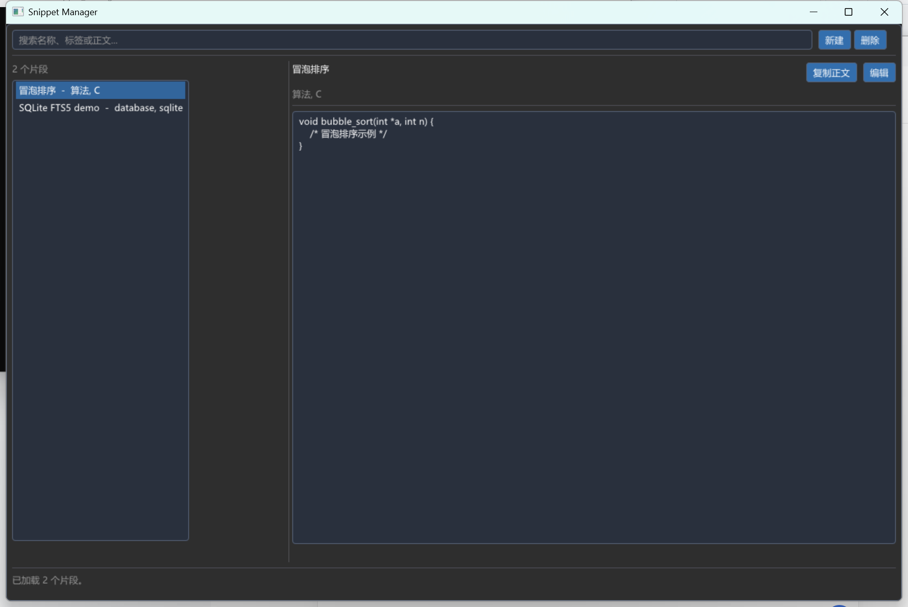

# Snippet Manager

> 一个本地代码片段管理器：用 **C** 写界面与业务逻辑，基于 **cimgui + SDL2/OpenGL3 + SQLite FTS5**，支持中文检索、功能说明和一键复制。


[](LICENSE)



## 功能

- **片段管理**：新建、编辑、删除代码片段。
- **字段完整**：名称、标签、功能说明、代码正文。
- **实时检索**：搜索范围限定在**名称 + 标签**，支持中文任意位置匹配。
  - 例如名称是“通用哈希表”，搜索 `哈希`、`通用` 都能命中。
- **中文输入**：正常显示输入法候选框，并在界面中显示组合中的拼音。
- **一键复制**：把完整正文复制到系统剪贴板。
- **本地优先**：SQLite 单文件存储，不依赖任何云服务。
- **双版本 exe**：控制台调试版 + 无控制台的 GUI 版。
- **离线构建**：依赖源码放在 `third_party/`，不需要 vcpkg 或网络。

## 技术栈

| 组件 | 用途 |
| --- | --- |
| C11 | 应用层、数据库层 |
| cimgui / Dear ImGui 1.93 | GUI，C API 调用 |
| SDL2 2.30.9 | 窗口、输入、IME |
| OpenGL 3.0 / GLSL 130 | 渲染后端（macOS 为 3.2 Core / GLSL 150） |
| SQLite 3.46.1 + FTS5 | 本地存储与全文索引 |
| CMake 3.20+ | 构建 |

> Dear ImGui 及官方后端是 C++ 实现，因此构建需要 C++17 编译器；业务代码全部是 C。

## 快速开始

### 环境要求

- CMake ≥ 3.20
- MinGW-w64（推荐）或 MSVC
- 支持 OpenGL 的桌面环境
- Linux 额外需要 OpenGL/X11 开发包

### Windows（MinGW-w64）

```powershell
git clone https://github.com/Shinece1/snippet-manager.git
cd snippet-manager

cmake -S . -B build -G "MinGW Makefiles" -DCMAKE_BUILD_TYPE=Release
cmake --build build --parallel
```

如果 CMake 找不到编译器，可显式指定：

```powershell
cmake -S . -B build -G "MinGW Makefiles" `
  -DCMAKE_C_COMPILER=C:/mingw64/bin/gcc.exe `
  -DCMAKE_CXX_COMPILER=C:/mingw64/bin/g++.exe `
  -DCMAKE_BUILD_TYPE=Release
```

### MSVC

```powershell
cmake -S . -B build -G "Visual Studio 17 2022" -A x64
cmake --build build --config Release
```

### Linux / macOS

```bash
cmake -S . -B build -DCMAKE_BUILD_TYPE=Release
cmake --build build --parallel
```

### 构建产物

| 文件 | 说明 |
| --- | --- |
| `build/snippet_manager.exe` | 控制台版本，保留终端错误输出 |
| `build/SnippetManager.exe` | Windows GUI 版本，双击不弹控制台 |

Windows 下两个 exe 都静态链接了 SDL2 和 MinGW 运行时，不需要额外 DLL。

## 使用

```powershell
# GUI 版（推荐双击或使用桌面快捷方式）
.\build\SnippetManager.exe

# 控制台版，可指定数据库路径
.\build\snippet_manager.exe D:\data\my-snippets.db
```

| 操作 | 行为 |
| --- | --- |
| 顶部搜索框 | 输入即过滤；只搜索名称和标签 |
| 新建 | 填写名称、标签、说明、正文；名称和正文必填 |
| 点击列表项 | 右侧显示功能说明和完整正文 |
| 复制正文 | 一键写入系统剪贴板 |
| 编辑 | 预填全部字段，保存为 `UPDATE` |
| 删除 | 二次确认后删除，并同步 FTS5 索引 |

### 中文输入

程序在创建窗口前启用 SDL 的原生 IME UI，并在窗口获得焦点后启动文本输入：

```c
SDL_SetHint(SDL_HINT_IME_SHOW_UI, "1");
SDL_SetHint(SDL_HINT_IME_INTERNAL_EDITING, "1");
SDL_StartTextInput();
```

同时拦截 `SDL_TEXTEDITING`，在编辑器下方和状态栏显示：

```text
输入中: ni'hao
```

即使候选框被遮挡，也能确认当前正在输入的内容。

## 检索设计

搜索**不使用** FTS5 `MATCH`，而是对名称和标签做 SQLite 子串匹配：

```sql
WHERE (instr(lower(name), lower(?1)) > 0
    OR instr(lower(tags), lower(?1)) > 0)
  AND ...
```

原因：FTS5 的 `unicode61` 分词器会把连续中文“通用哈希表”当成一个完整 token，搜索“哈希”无法命中中间部分。`instr()` 能得到符合直觉的子串结果。

- 多个搜索词用 **AND** 连接；
- ASCII 大小写不敏感；
- 说明和正文不参与列表搜索；
- FTS5 表仍然保留并自动同步，供后续全文检索或兼容使用。

## 数据存储

默认数据库是工作目录下的 `snippets.db`。核心表结构：

```sql
CREATE TABLE snippets (
    id          INTEGER PRIMARY KEY AUTOINCREMENT,
    name        TEXT NOT NULL,
    tags        TEXT NOT NULL DEFAULT '',
    description TEXT NOT NULL DEFAULT '',
    body        TEXT NOT NULL,
    created_at  TEXT NOT NULL DEFAULT (...),
    updated_at  TEXT NOT NULL DEFAULT (...)
);

CREATE VIRTUAL TABLE snippets_fts USING fts5(
    name, tags, body,
    content='snippets',
    content_rowid='id',
    tokenize='unicode61 remove_diacritics 2'
);
```

- 旧版本数据库打开时会自动执行 `ALTER TABLE ... ADD COLUMN description`，不会丢失已有片段。
- `AFTER INSERT / UPDATE / DELETE` 触发器维护 FTS5 索引。
- 启动时执行一次索引 `rebuild`，修复外部工具修改造成的索引不一致。
- 所有 SQL 使用预编译语句和 `sqlite3_bind_*`，不拼接用户输入。

> 数据库文件已被 `.gitignore` 排除，不会误传到 GitHub。

## 项目结构

```text
.
├── CMakeLists.txt
├── src/
│   ├── main.c                     # SDL2/OpenGL3、ImGui 界面、主循环、IME
│   ├── snippet_db.c/.h            # SQLite CRUD、迁移、名称/标签检索
│   ├── cimgui_compat.h            # ImGui_* → cimgui ig* 的 C 宏映射
│   ├── imgui_backend_sdl2.cpp     # SDL2 后端 C linkage 包装
│   └── imgui_backend_opengl3.cpp  # OpenGL3 后端 C linkage 包装
├── third_party/                   # 裁剪后的离线依赖源码
├── docs/preview.png
└── README.md
```

## 常见问题

<details>
<summary><b>为什么需要 C++ 编译器？</b></summary>

Dear ImGui 的核心实现和 SDL2/OpenGL3 后端是 C++。应用层、数据库层和所有业务逻辑是 C；cimgui 提供 C ABI，两个 `.cpp` 文件只负责给后端加 C linkage。
</details>

<details>
<summary><b>没有网络能构建吗？</b></summary>

可以。`third_party/` 已包含 cimgui、Dear ImGui、SQLite 和 SDL2 源码。删除该目录后，CMake 才会尝试下载固定版本依赖。
</details>

<details>
<summary><b>中文显示成方块怎么办？</b></summary>

程序会尝试加载微软雅黑、黑体、Noto Sans CJK、PingFang 等系统字体；找不到时回退到英文界面。安装任意 CJK 字体，或修改 `load_ui_font()` 中的候选路径。
</details>

<details>
<summary><b>Windows 提示“未知发布者”怎么办？</b></summary>

exe 没有数字签名，Windows 会显示安全警告。点“运行”即可；如果希望彻底消除，需要购买代码签名证书，或在本机安装自签名证书后重新签名。
</details>

<details>
<summary><b>数据库在哪里？</b></summary>

默认是启动时工作目录下的 `snippets.db`。控制台版支持传入路径；GUI 版使用快捷方式的工作目录。请自行备份数据库文件。
</details>

## 贡献

欢迎提交 Issue 或 Pull Request：

1. Fork 本仓库；
2. 新建分支：`git checkout -b feat/your-feature`；
3. 提交并推送；
4. 发起 Pull Request。

如果改动涉及数据库结构，请同时更新 `snippet_db.c` 中的迁移逻辑和本 README。

## 致谢

- [Dear ImGui](https://github.com/ocornut/imgui)
- [cimgui](https://github.com/cimgui/cimgui)
- [SDL2](https://github.com/libsdl-org/SDL)
- [SQLite](https://www.sqlite.org/)

第三方源码的许可证保留在 `third_party/` 对应目录中。

## License

本项目采用 [MIT License](LICENSE) 发布。

Copyright (c) 2026 Shinece
